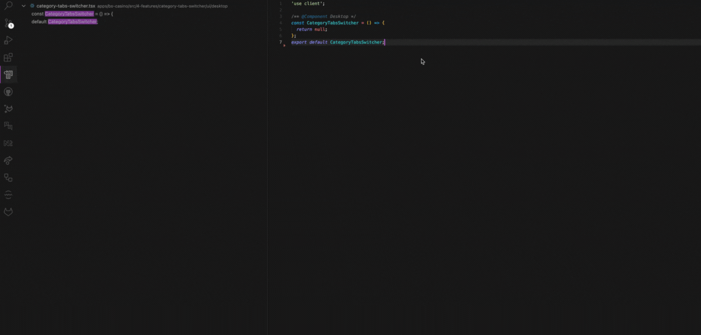

<h1 align="center">
  
  <br/>
  Dynamic Import References
</h1>

<p align="center">
  <strong> ⚡️ Supercharge VS Code's "Find All References" with React.lazy(), Next.js dynamic(), and @loadable/component detection</strong><br/>
</p>

<div align="center" style="margin: 24px 0; padding: 16px;">
  <a href="https://marketplace.visualstudio.com/items?itemName=bubablue00.dynamic-import-references" style="margin: 0 8px 12px 8px; display: inline-block;">
    
  </a>
  <a href="https://marketplace.visualstudio.com/items?itemName=bubablue00.dynamic-import-references" style="margin: 0 8px 12px 8px; display: inline-block;">
    
  </a>
  <a href="LICENSE" style="margin: 0 8px 12px 8px; display: inline-block;">
    
  </a>
  <a href="https://github.com/bubablue/dynamic-import-references/stargazers" style="margin: 0 8px 12px 8px; display: inline-block;">
    
  </a>
</div>

<p align="center">
  
</p>

<div align="center">

### ⚡️ **Level Up Your Stack Instantly**

</div>

<blockquote align="center">
<p>✨ <strong>Essential for teams using code splitting, lazy loading, and modern React patterns</strong> ✨</p>
<p>This extension is your <em>secret weapon</em> for navigating modern React codebases. It bridges the gap between VS Code's static analysis and React's dynamic patterns, ensuring <strong>zero missed references</strong> in your lazy-loaded components.</p>
</blockquote>

<div align="center">

</div>

## 📑 Table of Contents

- ✨ [Why You'll Love This Extension](#-why-youll-love-this-extension)
  - 🎯 [Smart React & Next.js Detection](#-smart-react--nextjs-detection)
  - ⚡ [Zero Configuration](#-zero-configuration)
  - 🔧 [Developer Friendly](#-developer-friendly)
  - 🎨 [Perfect For React Ecosystems](#-perfect-for-react-ecosystems)
- 🚀 [Quick Start](#-quick-start)
  - 📦 [Installation](#-installation-click-to-expand)
  - 🎯 [How to Use](#-how-to-use)
- 📋 [Supported Patterns & Languages](#-supported-patterns--languages)
  - 🔍 [Detection Examples](#-detection-examples)
- ⚙️ [Configuration](#️-configuration)
- 🛠️ [Development & Contributing](#️-development--contributing)
  - 🚀 [Local Development Setup](#-local-development-setup)
  - 🤝 [How to Contribute](#-how-to-contribute)
- 💝 [Support](#-support)
- 📄 [License](#-license)


## ✨ Why You'll Love This Extension

### **Smart React & Next.js Detection**
Automatically finds React lazy, Next.js dynamic, and @loadable/component imports that VS Code's built-in search misses:
```jsx
// These are now included in "Find All References"!
const LazyComponent = React.lazy(() => import('./MyComponent'));
const DynamicComponent = dynamic(() => import('./MyComponent'));
const LoadableComponent = loadable(() => import('./MyComponent'));
```

### ⚡ **Zero Configuration**
Just install and go! Works seamlessly with:
- **React** code splitting with `React.lazy()`
- **Next.js** dynamic imports with `dynamic()`
- **@loadable/component** for advanced code splitting
- Any React-based framework using these patterns
- Custom lazy loading implementations

### 🔧 **Developer Friendly**
- **No performance impact** - only runs when you need it
- **TypeScript aware** - understands your type definitions
- **Path resolution** - handles aliases and relative imports
- **Monorepo ready** - works with complex project structures

### 🎨 **Perfect For React Ecosystems**
Designed specifically for React and Next.js projects:
- ⚛️ **React** with lazy loading
- 🔺 **Next.js** with dynamic imports
- 📱 **React Native** Metro bundler
- 🖼️ **Gatsby** code splitting
- 📦 Any React-based framework  

## 🚀 Quick Start

<details>
<summary><strong>📦 Installation (Click to expand)</strong></summary>

### Method 1: VS Code Marketplace (Recommended)
1. Open **VS Code**
2. Press `Ctrl+Shift+X` (or `Cmd+Shift+X` on macOS)
3. Search for **"Dynamic Import References"**
4. Click **Install** ✨

### Method 2: Command Line
```bash
code --install-extension bubablue00.dynamic-import-references
```

### Method 3: VSIX File
Download the latest `.vsix` file from [releases](https://github.com/bubablue/dynamic-import-references/releases) and install manually.

</details>

### 🎯 How to Use

1. **Open any React/Next.js file** in your project
2. **Right-click** on a component name that's used in `React.lazy()`, `dynamic()`, or `loadable()`
3. **Select "Find All References"** (or press `Shift+F12`)
4. **Enjoy complete results** including lazy, dynamic, and loadable imports! 🎉

> **Pro Tip:** Works especially well with React components that are code-split using `React.lazy()`, Next.js `dynamic()`, or `@loadable/component` imports!

## 📋 Supported Patterns & Languages

<div align="center">

| Language | Extensions | Supported Patterns |
|----------|------------|-------------------|
| **JavaScript** | `.js`, `.jsx`, `.mjs`, `.cjs` | `React.lazy()`, `dynamic()`, `loadable()`, `import()` |
| **TypeScript** | `.ts`, `.tsx`, `.mts`, `.cts` | `React.lazy()`, `dynamic()`, `loadable()`, `import()`, with types |

</div>

### ✅ **Detection Examples**

```jsx
// ✅ All of these patterns are detected:

// React lazy loading
const LazyComponent = React.lazy(() => import('./components/LazyComponent'));
const AnotherLazy = lazy(() => import('./components/AnotherComponent'));

// Next.js dynamic imports
const DynamicComponent = dynamic(() => import('./components/Button'));
const ConditionalComponent = dynamic(() => import('./components/Modal'), {
  ssr: false
});

// @loadable/component imports
import loadable from '@loadable/component';
const LoadableComponent = loadable(() => import('./components/LoadableComponent'));
const LoadableWithOptions = loadable(() => import('./components/Advanced'), {
  fallback: <div>Loading...</div>
});

// Variable declarations with lazy/dynamic/loadable
let MyLazyComp = React.lazy(() => import('./MyComponent'));
var MyDynamicComp = dynamic(() => import('./MyComponent'));
const MyLoadableComp = loadable(() => import('./MyComponent'));
const MyComponent = lazy(() => import('./path/to/MyComponent'));

// TypeScript with types
const TypedComponent: React.ComponentType = lazy(() => import('./TypedComponent'));
const TypedLoadable: LoadableComponent<any> = loadable(() => import('./TypedLoadable'));
const WithProps = dynamic<Props>(() => import('./WithProps'), { ssr: false });

// Wrappers used as object values
export const Views = {
  card: dynamic(() => import('./views/card')),
  [Kind.Spread]: dynamic(() => import('./views/spread')),
};

// Named exports picked from the module
const Chart = lazy(() => import('./charts').then((m) => ({ default: m.Chart })));

// Plain import() calls
const { loadUser } = await import('./api/user');
const barrel = await import('./widgets/banner');
barrel.default;
```

Imports are resolved like TypeScript resolves them: `paths` aliases (longest match wins), `baseUrl`, `extends` chains and the importer's own `tsconfig.json`/`jsconfig.json`. Barrels (`export { default } from './ui/banner'`), `export *` and `export default memo(Component)` are followed to the real declaration, so Find All References works from the component itself or from any file that imports it.

### ❌ **Not Supported**
```javascript
// Computed specifiers can't be resolved statically:
const page = await import(`./pages/${name}`);
```

## ⚙️ Configuration

**Zero configuration required!** 🎉 The extension works automatically when enabled.

### 🎛️ Custom Matchers

Want to add support for your own lazy loading functions or libraries? You can configure custom matchers in your VS Code settings:

<details>
<summary><strong>📝 Custom Matchers Configuration (Click to expand)</strong></summary>

Add this to your VS Code `settings.json`:

```json
{
  "dynamicImportReferences.customMatchers": [
    {
      "kind": "named",
      "name": "asyncComponent", 
      "source": "react-async-component",
      "allowAlias": true
    },
    {
      "kind": "member",
      "namespace": "React",
      "member": "lazy",
      "source": "react"
    },
    {
      "kind": "identifier",
      "name": "myCustomLoader",
      "requireImport": false
    }
  ]
}
```

#### Configuration Options

| Property | Type | Description | Required |
|----------|------|-------------|----------|
| **`kind`** | `string` | How the function is referenced:<br/>• `"named"` = named import (`import { lazy }`)<br/>• `"default"` = default import (`import dynamic`)<br/>• `"member"` = namespace member (`React.lazy`)<br/>• `"identifier"` = local/project utility | ✅ |
| **`name`** | `string` | Function name to detect (e.g., `"lazy"`, `"loadable"`, `"myLazy"`) | For `named`, `member`, `identifier` |
| **`source`** | `string` | Module specifier (e.g., `"react"`, `"@loadable/component"`) | For `named`, `default`, `member` |
| **`namespace`** | `string` | Namespace identifier for member access (e.g., `"R"` in `R.lazy`) | For `member` |
| **`member`** | `string` | Member function name (e.g., `"lazy"` in `R.lazy`) | For `member` |
| **`allowAlias`** | `boolean` | Allow aliased imports (e.g., `{ lazy as myLazy }`) | Optional (default: `true`) |
| **`requireImport`** | `boolean` | Require function to be imported vs. locally declared | Optional (default: `true`) |
| **`memberAccess`** | `boolean` | Back-compat: allow member access patterns | Optional (default: `false`) |

#### Examples

**Named Import Pattern:**
```json
{
  "kind": "named",
  "name": "asyncComponent",
  "source": "react-async-component"
}
```
Detects: `import { asyncComponent } from 'react-async-component'`

**Member Access Pattern:**
```json
{
  "kind": "member", 
  "namespace": "Utils",
  "member": "lazy",
  "source": "./utils"
}
```
Detects: `import * as Utils from './utils'` then `Utils.lazy(...)`

**Local Function Pattern:**
```json
{
  "kind": "identifier",
  "name": "myLazyLoader", 
  "requireImport": false
}
```
Detects: Locally defined `myLazyLoader` function

</details>

### 🔧 Built-in Patterns

The extension automatically detects these patterns without configuration:

| Library | Pattern | Example |
|---------|---------|---------|
| **React** | `lazy` | `const Comp = lazy(() => import('./Comp'))` |
| **Next.js** | `dynamic` | `const Comp = dynamic(() => import('./Comp'))` |
| **@loadable/component** | `loadable` | `const Comp = loadable(() => import('./Comp'))` |

## 🛠️ Development & Contributing

<details>
<summary><strong>🚀 Local Development Setup</strong></summary>

### Prerequisites

<div align="center">

**Node.js 24+**, **npm** and **VS Code 1.104+**

</div>

### Getting Started
```bash
# Clone the repository
git clone https://github.com/bubablue/dynamic-import-references.git
cd dynamic-import-references

# Install dependencies
npm install

# Open in VS Code
code .

# Start development
npm run watch:esbuild
```

### Running Tests
```bash
# Run all tests
npm test

# Run tests in watch mode
npm run watch-tests
```

### Debugging
1. Press `F5` to launch the Extension Development Host
2. Open a test project in the new window
3. Test the extension functionality

To try a local build on a real project while the Marketplace version is installed, start an isolated instance instead of installing the `.vsix`:

```bash
npm run package
code --extensionDevelopmentPath="$PWD" \
  --extensions-dir /tmp/dir-extensions \
  --user-data-dir /tmp/dir-user \
  /path/to/project
```

### Building for Release
```bash
npm run package
```

</details>

<details>
<summary><strong>🤝 How to Contribute</strong></summary>

We welcome contributions! Here's how you can help:

1. **🐛 Report Bugs** - Found an issue? [Open an issue](https://github.com/bubablue/dynamic-import-references/issues)
2. **💡 Suggest Features** - Have an idea? We'd love to hear it!
3. **📝 Improve Documentation** - Help make the docs even better
4. **🔧 Submit Code** - Fix bugs or add features with a PR

### Contribution Guidelines
- Fork the repository
- Create a feature branch (`git checkout -b feature/amazing-feature`)
- Commit your changes (`git commit -m 'Add amazing feature'`)
- Push to the branch (`git push origin feature/amazing-feature`)
- Open a Pull Request

</details>

<br/>

<table>
<tr>
<td width="50%">

#### 🎯 **Core Features** 
- 🔍 **React.lazy() detection** - *Fully implemented*
- ⚡ **Next.js dynamic() detection** - *Production ready*
- 📦 **@loadable/component support** - *Complete integration*
- 📘 **TypeScript support** - *Complete with types*
- 🎨 **Custom import patterns** - *Configurable matchers*
- 🔗 **Path alias resolution** - *All aliases supported*

</td>
<td width="50%">

#### 🔮 **Future Enhancements**
- 🔥 **Webpack lazy imports** - *Coming soon*
- 📱 **React Native support** - *Under consideration*
- 🚀 **Performance optimizations** - *Ongoing*
- 🎯 **Enhanced pattern detection** - *Continuous improvement*

</td>
</tr>
</table>

<div align="center">

**💡 Have an idea?** [Suggest a feature](https://github.com/bubablue/dynamic-import-references/issues/new?template=feature_request.md) • **🐛 Found a bug?** [Report it](https://github.com/bubablue/dynamic-import-references/issues/new?template=bug_report.md)

---

</div>

## 💝 Support

<div align="center">

**Love this extension?** Help us grow! 

[](https://github.com/bubablue/dynamic-import-references)
[](https://marketplace.visualstudio.com/items?itemName=bubablue00.dynamic-import-references)
[](https://twitter.com/intent/tweet?text=Check%20out%20this%20awesome%20VS%20Code%20extension%20for%20dynamic%20imports!&url=https://marketplace.visualstudio.com/items?itemName=bubablue00.dynamic-import-references)

</div>

## 📄 License

This project is licensed under the **MIT License** - see the [LICENSE](LICENSE) file for details.

---

<div align="center">

**Made with ❤️ by developers, for developers**

<sub>Icon by <a href="https://www.freepik.com/icon/search_5459841">Arkinasi</a></sub>

</div>
